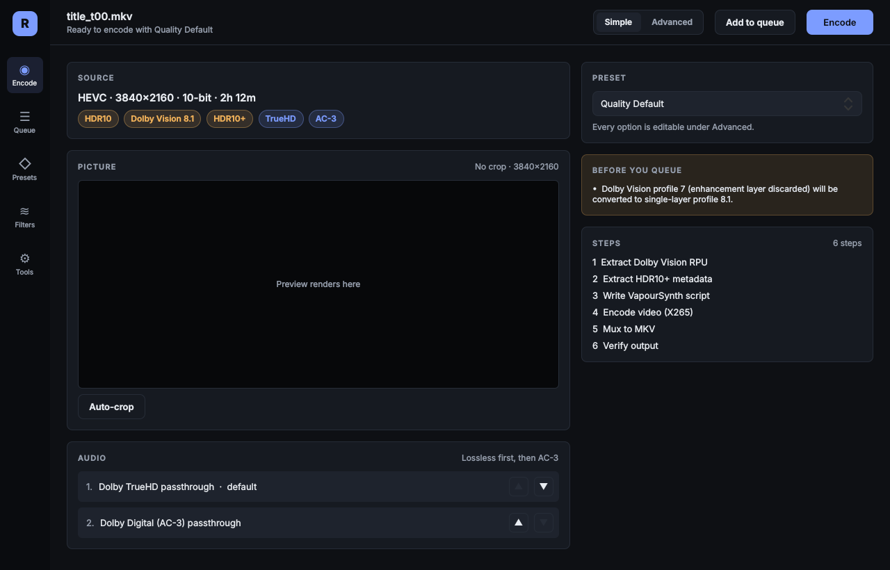
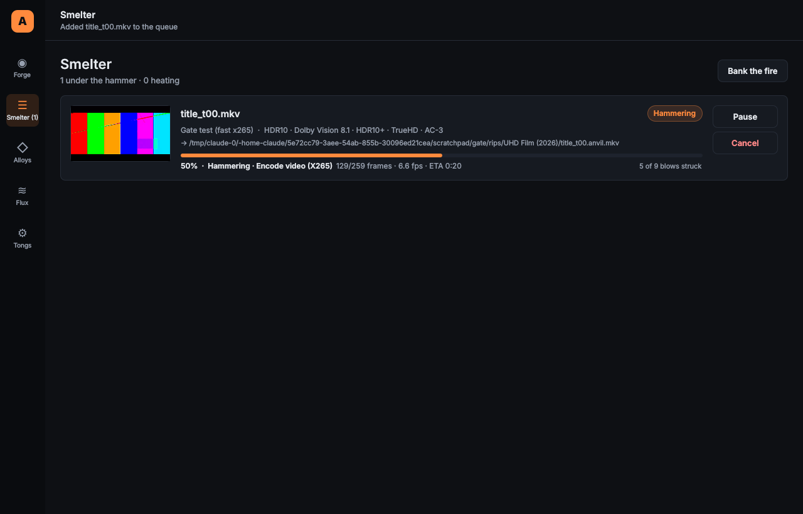
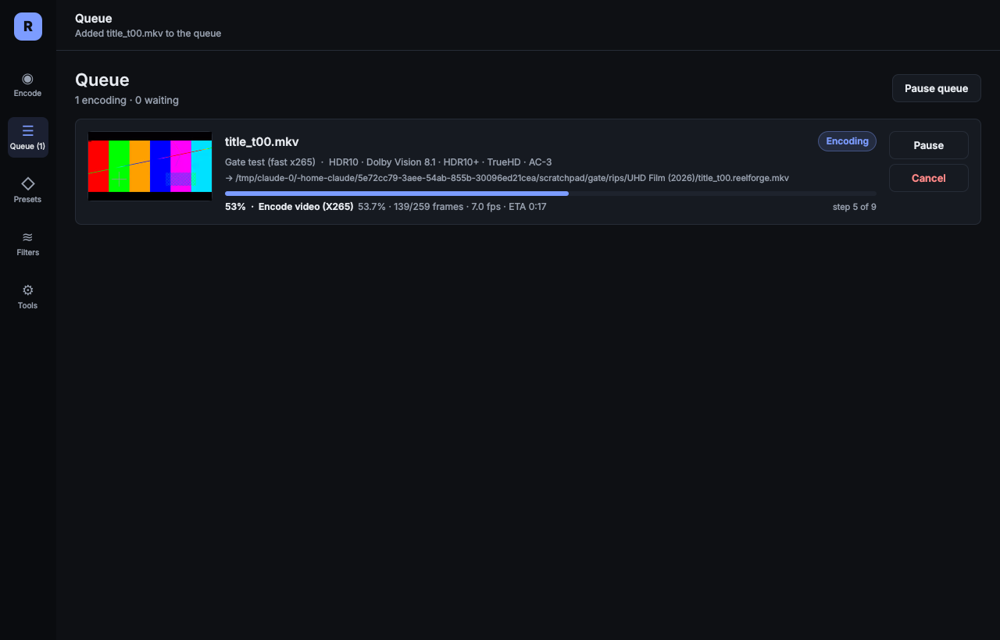

# Anvil

A Linux video encoding GUI in the spirit of StaxRip: simple on the surface, with every option available underneath. Rust engine, Qt 6 Quick (QML) front end via CXX-Qt.



Anvil was called Reelforge until November 2026. On first start it moves your presets (`~/.config/reelforge`) and queue (`~/.local/share/reelforge`) to the new `anvil` folders, leaving a link at the old paths, and the install script removes the old `reelforge` programs and menu entry. Old job files still load.

## Forge mode

An optional theme for the name: your rip is the raw ore and Anvil the forge. Turn it on under **Tools → Appearance** (saved in `~/.config/anvil/settings.toml`), or for one run with `anvil-gui --forge`. Only the words and the accent colour change; every job runs exactly the same.

| Plain | Forge mode |
| --- | --- |
| Encode page, Source | Forge, Ore |
| Queue, Waiting, Encoding, Paused | Smelter, Heating, Hammering, Banked |
| Encode button, Add to queue | Hammer it, To the smelter |
| Muxing and HDR10+ injection (live step) | Tempering |
| Done, Failed, Cancelled, Interrupted | Tempered, Cracked, Quenched, Gone cold |
| Verification, Details | Assay |
| Presets, Filters, Tools | Alloys, Flux, Tongs |
| Start queue, Pause queue | Light the fire, Bank the fire |



## What works today (v1.0)

| Area | Status |
| --- | --- |
| Probe (ffprobe JSON to a typed source model, HDR10, Dolby Vision, HDR10+, Atmos/DTS:X, VFR hint, interlacing) | Working, tested |
| Audio rule: native lossless first, then AC-3 (passthrough if present, else encoded), per-file reorder | Working, tested |
| Layered TOML presets (built-in, `inherits`, user folder, per-job override) | Working, tested |
| VapourSynth script generation from filter blocks (BestSource, IVTC, QTGMC, denoise, deband, resize, custom) | Working, tested |
| Auto-crop (FFmpeg cropdetect sampling, safe minimum, mod-2) | Working, tested on real video |
| Command builders: x265, SVT-AV1, NVEncC with HDR10 signalling from the source | Working, tested |
| Dolby Vision (profile 7 to 8.1, crop-adjusted RPU) and HDR10+ extraction/injection steps | Planned as commands, tested |
| VFR timecode extraction and re-mux | Planned as commands, tested |
| mkvmerge mux with track order, flags and subtitle selection | Planned as commands, tested |
| CLI (`probe`, `plan`, `autocrop`, `presets`) | Working |
| Qt GUI shell (drop zone, source badges, preset picker, auto-crop, audio reorder, warnings, Simple/Advanced plan view) | Working |
| Two-pass probe with timeout (headers, then the first video frame only); drag-and-drop paths with spaces | Working, tested |
| Tool detection with versions (`anvil tools`, Tools page) | Working, tested |
| Built-in job runner: parallel steps, live progress, Ctrl+C cancel, per-step logs (`anvil run`) | Working, tested end to end on UHD HDR sources |
| Output verification: HDR10, Dolby Vision, HDR10+, audio order, size, duration (ffprobe + MediaInfo) | Working |
| M2TS sources: track-ID remapping, embedded AC-3 cores, Dolby Vision from frames | Working, tested |
| Job files (`job.toml`) for reproducible re-runs (`anvil run --job`) | Working |
| Run-script export: each job as a standalone bash script | Working, tested end to end |
| GUI pages: Encode, Queue, Presets, Filters, Tools | Working |
| GUI queue: one-click Encode, SQLite-backed (survives restarts), pause/resume/cancel/retry/reorder, CPU and per-GPU slots, live progress and thumbnails, verification details | Working, tested end to end |
| Frame preview: scrub, draggable crop handles, exact after-filters frame via `vspipe`, HDR tone-mapped | Working |
| Folder batch add (file dialog, folder dialog or drag and drop) | Working |
| Blu-ray and DVD folders: main title found and copied to MKV, then opened; any other title from the Source card or `anvil disc --title` | Working, tested on synthetic discs |
| DVD IFO reading: titles (program chains), exact cell copy, first angle, chapters, audio languages | Working, tested on a synthetic DVD |
| Audio editor: per track keep, AC-3, E-AC-3, AAC, Opus, FLAC or DTS core, bitrate, downmix, loudness normalisation (EBU R128, one fixed gain), delay, title, add and remove | Working, tested end to end |
| Subtitle editor: keep, reorder, language, title, default and forced flags, add SRT/ASS/SUP/VobSub files, forced captions only from Blu-ray PGS | Working, tested end to end |
| Chapter editor: keep, drop or edit; rename, retime, add at the preview position, every N minutes, import and export Matroska XML or OGM | Working, tested end to end |
| Size target: output at most 33% of the source (audio included) by default; sample encodes raise the CRF only as far as needed | Working, tested |
| Direct FFmpeg decode for crop-only jobs (no BestSource indexing pass) | Working, tested |
| DVD subtitles: VobSub extracted from the VOBs with the IFO palette and languages | Working, tested on a synthetic DVD |
| OCR of PGS and VobSub subtitles to SRT with Tesseract (`anvil ocr`, `--sub N,ocr`, OCR toggle in the subtitle editor) | Working, tested end to end |
| Dolby Vision L5 active area recalculated for the crop, scene by scene (partial crops and IMAX-style aspect changes), checked frame by frame after the encode | Working, tested |
| HDR10+ checks: metadata for every frame, processing windows | Working, tested |
| Filter editor: blocks with strength presets (denoise, deband, sharpen, grain, QTGMC, resize, custom code), source filter, plugin detection with install hints, hand-edited script | Working, tested |
| Preset editor: edit any preset, save as your own (stores only the differences), conditional rules per source (resolution, HDR, Dolby Vision, interlacing, length, size) | Working, tested |
| Forge mode: optional forge-themed wording and ember accent | Working |
| Encoders: x265, x264, SVT-AV1 and rav1e on the CPU; NVEncC, QSVEncC, VCEEncC and FFmpeg VAAPI on the GPU, with HDR10 and (HEVC) Dolby Vision and HDR10+ | Working; CPU encoders and VAAPI commands tested here, GPU encoders need your hardware |
| Hardware detection: `--check-hw` for NVIDIA, Intel and AMD, `vainfo` for VAAPI, on the Tools page and in `anvil tools`; GPU presets warn when their encoder is not usable | Working, tested |
| Encoder option pages for every encoder, from schema files, in the preset editor and `anvil options`; checked against each tool's `--help` | Working, tested |
| Drop files and folders anywhere on the Encode screen | Working |
| Size target (at most a set share of the source, 33% by default) for every encoder: sample encodes pick each encoder's own quality value (CRF, QVBR, ICQ, QP or quantizer) | Working; tested with x265 and SVT-AV1 (1.7 GB of a 1.8 GB target) |
| Time estimate before queueing ("Estimate time", `anvil estimate`): short timed encodes on this machine with the job's own settings | Working; within about 15% of the real encode in testing |
| AppImage (Anvil and Qt; tools from your system) and Flatpak manifest (everything bundled) | AppImage built and tested; Flatpak needs a first build with Flathub access |

The engine plans jobs as pure data (files to write, commands to run, dependencies), which keeps every decision unit-testable, then the runner executes the plan and verifies the result. `anvil run` encodes from the command line, and **Encode** in the GUI queues the job and starts it straight away. Jobs wait in a held queue when added with **Add to queue**, so you can line up a batch and press **Start queue**.



## Layout

```
crates/
  anvil-core/   Qt-free engine: probe, model, audio, crop, presets, scriptgen, encoder, pipeline
  anvil-cli/    `anvil` binary, shares the planner with the GUI
  anvil-app/    `anvil-gui` binary: CXX-Qt bridge (src/bridge.rs, src/tokens.rs) + QML (qml/)
presets/            Built-in presets (TOML), compiled into the core
```

## Quick install on CachyOS / Arch

```sh
./install-cachyos.sh --install                         # build deps, build, test, install with a menu entry
./install-cachyos.sh --with-tools --install            # also x265, SVT-AV1, MKVToolNix, VapourSynth and its plugins, dovi_tool...
./install-cachyos.sh --help                            # all options (--gpu, --cpu-only, --no-gui, --skip-tests, --yes, --dry-run)
```

Run it as your normal user; it uses `sudo` only for `pacman`.

**GPU encoders.** The script asks once, at the start, whether to install your graphics card's encoder (NVEncC, QSVEncC or VCEEncC from the AUR; NVIDIA's also needs the 4 GB CUDA toolkit, so this can take a while). Answer no and Anvil stays CPU-only: no GPU encoders are installed, and the GPU presets and checks are hidden. `--gpu` or `--cpu-only` answers in advance, and the Tools page has a switch to change it later. The Presets page and the Encode page's preset list only show presets this machine can use; "Show them" lists the rest. Optional packages that are missing from your repositories or the AUR are skipped with a warning rather than stopping the build.

## AppImage and Flatpak

**AppImage.** `bash packaging/appimage/build-appimage.sh` makes `dist/Anvil-x86_64.AppImage` with Anvil and its Qt libraries. The encoding tools come from your system (VapourSynth's Python plugins cannot be bundled reliably), and the Tools page lists anything missing. `./Anvil-x86_64.AppImage cli tools` runs the command-line tool.

**Flatpak.** `packaging/flatpak/io.github.anvil_video.Anvil.yml` bundles FFmpeg, x265, x264, SVT-AV1, VapourSynth with BestSource and the filter plugins, MKVToolNix, MediaInfo, Tesseract, dovi_tool and hdr10plus_tool. Build it with `flatpak-builder` (instructions at the top of the file), or push a `v*` tag to GitHub and `.github/workflows/release.yml` builds both packages and attaches them to a release. `packaging/flatpak/pin-commits.py` pins every source to its commit. The app id uses a placeholder (`io.github.anvil_video`): change it to your own GitHub name before publishing on Flathub.

## Building by hand

Requirements: Rust 1.85+, FFmpeg (ffprobe) on `PATH`. For the GUI: Qt 6 with Qt Quick and Quick Controls development files (Qt 6.4 or newer has been tested).

```sh
# Core and CLI only (no Qt needed)
cargo build
cargo test

# GUI
# Debian/Ubuntu: sudo apt install qt6-declarative-dev qml6-module-qtquick qml6-module-qtquick-controls \
#   qml6-module-qtquick-layouts qml6-module-qtquick-window qml6-module-qtqml-workerscript qml6-module-qtquick-templates
# Arch: sudo pacman -S qt6-declarative
cargo build -p anvil-app
cargo run -p anvil-app
```

If CXX-Qt cannot find Qt, point it at `qmake6` with `QMAKE=/usr/bin/qmake6`.

## Trying it

```sh
# What does Anvil see in a file?
cargo run -- probe /path/to/film.mkv

# Full plan with every command, using auto-crop
cargo run -- plan /path/to/film.mkv --autocrop -o ~/Videos/encodes

# Plan from a saved probe (no media needed)
cargo run -- plan crates/anvil-core/tests/fixtures/uhd_dovi_p7_truehd.json --from-json --crop 0,0,276,276

# Encode: plan, run with live progress, verify the result (Ctrl+C cancels)
cargo run --release -- run /path/to/film.mkv --autocrop -o ~/Videos/encodes

# Re-run a job exactly as before, from its saved job file
cargo run --release -- run --job ~/Videos/encodes/.anvil-work/film/job.toml

# Per-job tracks and chapters (the same edits as the GUI editors):
#   --audio N[:TARGET[:KBPS[:CHANNELS]]][,norm][,delay=MS][,title=TEXT]   (repeat, in order)
#   --sub N|FILE[,forced][,forced-only][,default][,lang=XX][,title=TEXT]  (repeat, in order)
#   --chapters keep|none|every=MINUTES|FILE.xml|FILE.txt
cargo run --release -- run film.mkv -o out --audio 1 --audio 1:ac3:640 --audio "2:opus:160:2,norm" \
  --sub 1 --sub "1,forced-only,default,title=Forced" --sub film.en.srt --chapters every=10

# Blu-ray or DVD folder: list titles, copy the main one (or --title ID) to MKV
cargo run -- disc /path/to/DISC_FOLDER
cargo run -- disc /path/to/DISC_FOLDER --copy --title 00801

# Chapters: list, generate, export as Matroska XML (.xml) or OGM (.txt)
cargo run -- chapters film.mkv --export film.chapters.xml
cargo run -- chapters film.mkv --every 10 --export film.chapters.txt

# Or write the job as a standalone bash script
cargo run -- script /path/to/film.mkv --autocrop -o ~/Videos/encodes
bash ~/Videos/encodes/film.anvil.sh

# Which encoding tools are installed?
cargo run -- tools

# How long will it take? (four short timed encodes with the job's own settings)
cargo run -- estimate film.mkv --preset fast-nvenc

# Encoder option pages, and a check against the installed tools' --help
cargo run -- options x265 --preset quality-default
cargo run -- options --check

# Presets
cargo run -- presets
cargo run -- presets --show av1-archive

# GUI with a saved probe, Advanced view, headless screenshot
cargo run -p anvil-app -- --load-probe crates/anvil-core/tests/fixtures/uhd_dovi_p7_truehd.json --advanced
QT_QPA_PLATFORM=offscreen cargo run -p anvil-app -- --open film.mkv --screenshot shot.png
```

## User presets

Drop TOML files in `~/.config/anvil/presets/`. Store only what you change:

```toml
inherits = "quality-default"
name = "My films"

[video.x265]
preset = "slower"

[audio]
languages = ["eng", "jpn"]
```

### Rules

A preset can change itself per source. Each rule applies when the source matches every condition given, in order, before any per-job edits:

```toml
[[rules]]
name = "UHD HDR: slower"
when = { resolution = "uhd", hdr = true }
set = { video = { x265 = { preset = "slow" } } }

[[rules]]
name = "Long DVDs: a little grain"
when = { resolution = "sd", longer_than_minutes = 60 }
set = { video = { x265 = { crf = { sd = 19.0 } } } }
add_filters = ["grain"]
```

Conditions: `resolution` (`sd`, `hd`, `uhd`), `hdr`, `dolby_vision`, `interlaced`, `longer_than_minutes`, `shorter_than_minutes`, `larger_than_gb`. Filters: `denoise`, `deband`, `sharpen`, `grain`, `qtgmc`, `resize`. The Presets page edits all of this without writing TOML; the Encode page and `anvil plan` show which rules applied.

## VapourSynth plugins

VapourSynth R80 and later (CachyOS ships R81) no longer load plugins from `/usr/lib/vapoursynth` or `vapoursynth.conf`, and the AUR plugin packages fail to build against it. So Anvil keeps its own plugin set: `./install-cachyos.sh --with-tools` runs `packaging/scripts/install-vs-plugins.py`, which takes each plugin's official PyPI build (checksum checked, no pip needed) and unpacks it into `~/.local/share/anvil/vs`. Anvil points VapourSynth there with `VAPOURSYNTH_EXTRA_PLUGIN_PATH`. Nothing is installed system-wide.

| Filter | Plugin |
| --- | --- |
| Source | BestSource (`bs`), L-SMASH (`lsmas`), D2V (`d2v`) |
| Inverse telecine | VIVTC |
| Deinterlace (the default for interlaced sources) | BWDIF |
| Denoise, Deband | [vszip](https://github.com/dnjulek/vapoursynth-zip) (NLMeans, Deband) |
| Sharpen | CAS |
| Film grain | AddNoise (`vsnoise`) |
| QTGMC (optional, finer deinterlacing) | havsfunc and vsjetpack from pip, plus mvtools and znedi3 (installed) |

`python3 packaging/scripts/install-vs-plugins.py --list` shows the exact versions. The old DFTTest and neo_f3kdb plugins use VapourSynth's API 3, which R80 and later cannot load, so Anvil no longer uses them.

## Name clash: Foundry's `anvil`

The command-line program is `anvil`. If you also have Foundry (the Ethereum toolkit) installed, it has its own `anvil` in `~/.foundry/bin`, and whichever folder comes first on your `PATH` wins. Check with `which -a anvil`; run ours as `~/.local/bin/anvil` if needed. The GUI is `anvil-gui` and does not clash.

## Design notes

- **Defaults come from the source.** Bit depth, HDR signalling, crop and audio order are derived from probing; the user confirms rather than configures.
- **Never silently degrade.** Anything that would drop Dolby Vision, HDR10+, lossless audio or VFR timing produces a warning on the job card (for example, the AV1 preset warns that Dolby Vision cannot be carried).
- **Preview equals output.** The same generated `.vpy` drives the preview (VSScript, in-process) and the encode (`vspipe` into the encoder).
- **Track IDs.** The planner uses ffprobe stream indices, which match mkvmerge track IDs for Matroska sources. For other containers the runner must re-map with `mkvmerge -J` (a warning is raised).

## Licence

Anvil is free software, licensed under the [GNU General Public License, version 3 or later](LICENSE) (GPL-3.0-or-later). You may use, study, change and share it; if you distribute a changed version, you must offer its source under the same licence. It comes with no warranty. Contributors are listed in [AUTHORS](AUTHORS).

The encoding tools Anvil drives (x264, x265, FFmpeg, MKVToolNix, VapourSynth and others) run as separate programs under their own licences. The AppImage includes Qt 6 under the LGPL-3.0, and the Flatpak builds several of the tools from source. [THIRD-PARTY.md](THIRD-PARTY.md) lists every component, its licence and where its source is; the same notice is installed with both packages and summarised on the Tools page.
