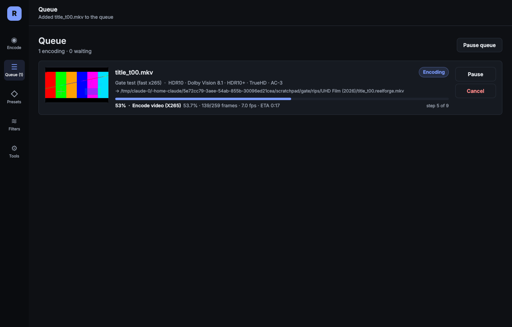
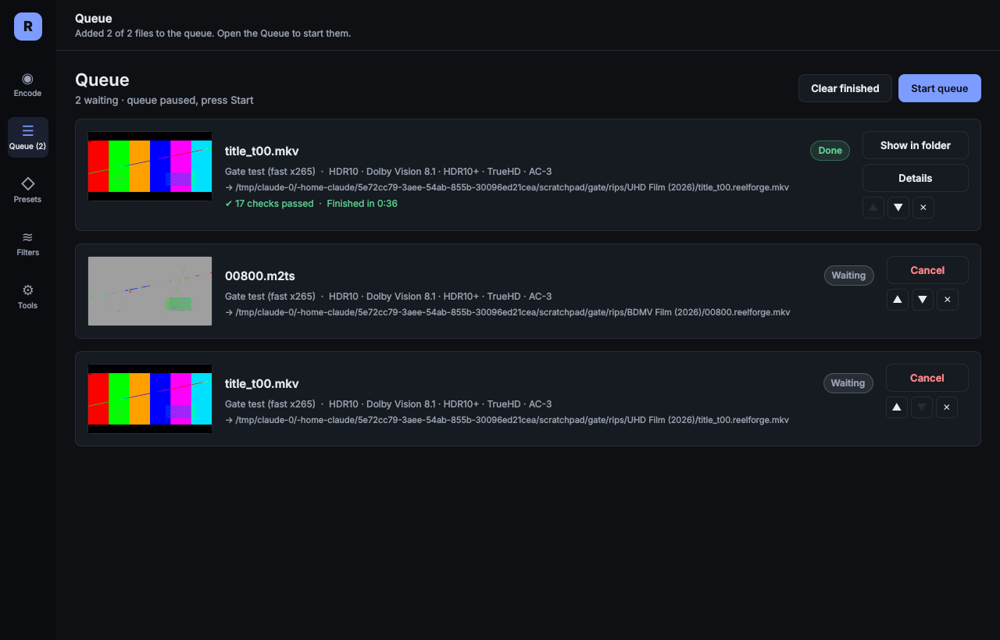
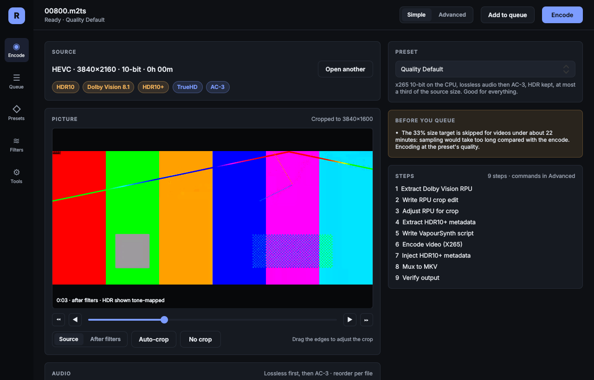
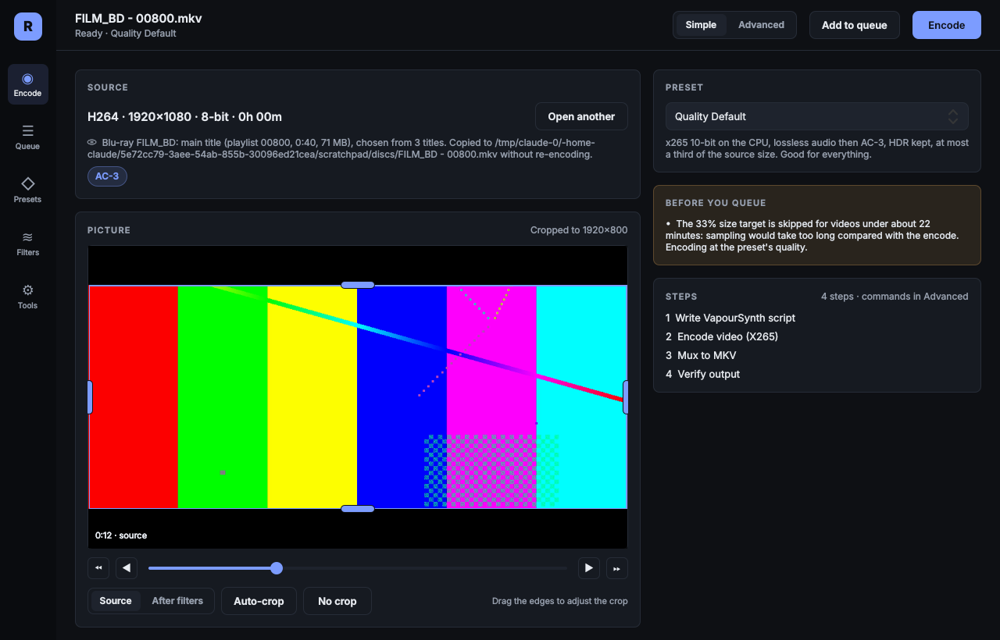

# Phase 2 gate: results

**Gate:** one-click encode of a single file from the GUI.

**Result: passed** (10 November 2026), using the same UHD test source as the [phase 1 gate](phase1-gate.md): 3840x2160 HEVC 10-bit with HDR10, Dolby Vision 8.1, HDR10+, TrueHD and AC-3.

## The run

The GUI was started headless (`QT_QPA_PLATFORM=offscreen`) with the developer hooks in `Main.qml`, which drive the same buttons a person presses:

```
anvil-gui --preset gate-fast --open ".../UHD Film (2026)/title_t00.mkv" \
  --encode --shots shots/ --quit-when-done --screenshot done.png
```

1. The file opens, is probed and auto-cropped to 3840x1600 without any further input.
2. **Encode** queues the job and starts the queue. The Queue page shows the status chip, a progress bar, the current step, fps, ETA and "N of M steps done", refreshed live from the runner thread.
3. The job finished in 0:36 with **17 checks passed** (HDR10 mastering display and light levels, Dolby Vision profile 8.1 with zeroed L5 offsets after the crop, HDR10+, audio order TrueHD then AC-3, size, duration).

`mediainfo` on the GUI's output: `3840 x 1600`, `10 bits`, HDR format `Dolby Vision / SMPTE ST 2094 App 4` (Dolby Vision plus HDR10+).

The test preset `gate-fast` inherits Quality Default and changes only the x265 speed preset to `ultrafast`, so the 4K encode takes seconds on the 2-core test machine.



## Other Phase 2 checks

| Check | Result |
| --- | --- |
| Queue survives a restart | The finished job and its verification were still listed after quitting and relaunching with the same data folder. A job running at exit returns as **Interrupted** with **Retry** (unit tested). |
| Folder batch add | Adding the `rips` folder queued both the MKV and the M2TS, each with its badges, thumbnail and output path, and left them waiting for **Start queue**. |
| M2TS thumbnails | The first batch run showed a grey smeared thumbnail for the M2TS (ffmpeg seeks mid-GOP in transport streams). Fixed by decoding keyframes only (`-skip_frame nokey`) for thumbnails and source previews. |
| After-filters preview | The exact frame from the job's VapourSynth script, rendered by `vspipe` and tone-mapped for display, cropped to 3840x1600. |
| Pause, resume, cancel, retry, reorder, slots | Covered by `queue.rs` unit tests, including killing the whole process group on cancel. |





## Completing Phase 2 (11 November 2026)

| Check | Result |
| --- | --- |
| Blu-ray folder | A synthetic disc with a real MPLS playlist joining two clips (`00800`, 40 s), a duplicate single-clip playlist and a short extra. Anvil chose `00800`, copied it to `FILM_BD - 00800.mkv` (40.05 s, both chapters), auto-cropped it to 1920x800 and encoded it from the GUI: 10 checks passed. |
| DVD folder | A VIDEO_TS with a menu VOB, a main title set split over three VOBs and a small extra. Anvil chose title set 01 and copied 30.0 s. Naming every VOB to mkvmerge would have doubled the film (56 s), because mkvmerge follows a VOB set by itself; only the first VOB is passed. |
| Disc progress | mkvmerge scans Blu-ray playlists with its own 0 to 100% before copying; that phase is skipped so the bar only counts the copy. |
| After-filters preview, crop-only jobs | Rendered from the same FFmpeg decode and crop as the encode: no BestSource indexing, and M2TS frames are clean because the seek starts two seconds early. |
| HDR preview speed | Scaling to preview size before tone mapping: 1.6 s instead of 4.6 s for a 4K Dolby Vision frame on the 2-core test machine, with no visible difference. |



## Notes

- Jobs with real VapourSynth filters still render "After filters" with `vspipe`, so the first frame of a big file waits for BestSource to index it.
- A DVD copy has no audio or subtitle language names, because those live in the disc menus (IFO files), which are not read yet. The Source card says so.
- Encrypted discs are not supported: rip them with MakeMKV first.
