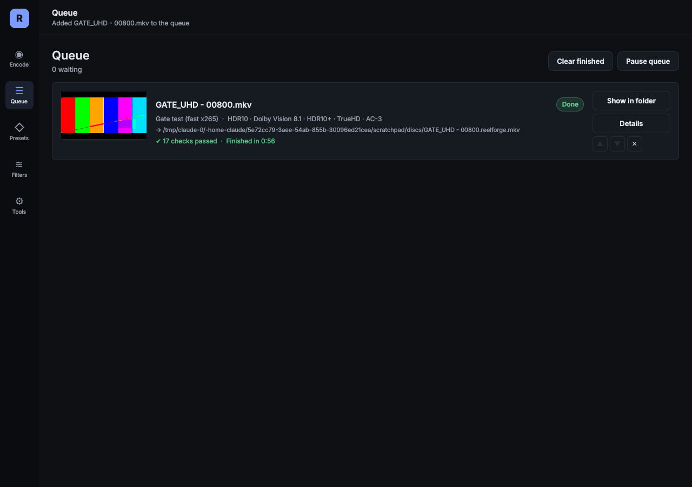
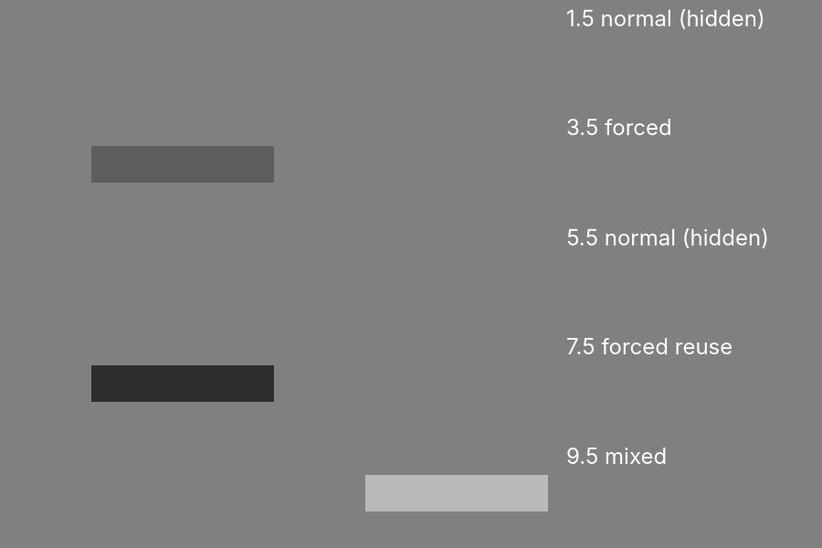
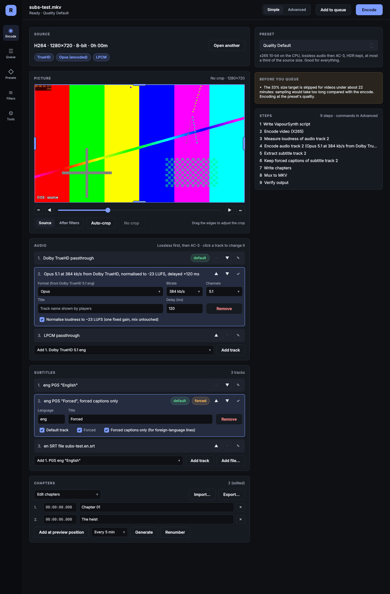
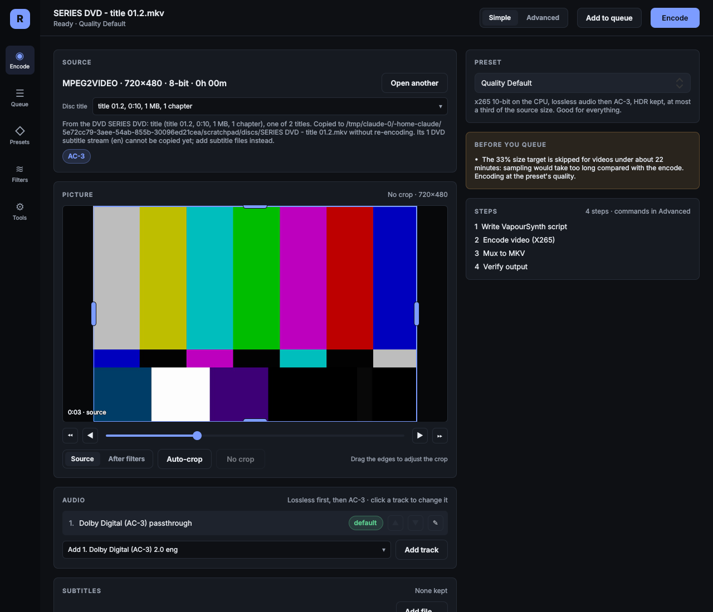

# Phase 3 gate: results

**Gate:** a full Blu-ray title to MKV with lossless then AC-3 audio.

**Result: passed** (11 November 2026).

## The run

The test disc `GATE_UHD` is a Blu-ray folder built from the real UHD test stream used in the earlier gates (HEVC 10-bit, HDR10, Dolby Vision 8.1, HDR10+, TrueHD 5.1 with its embedded AC-3 core, and an AC-3 5.1 track). Its main playlist `00800.mpls` joins two clips, as seamless-branching discs do, and a short extra playlist `00010.mpls` sits beside it.

```
anvil-gui --preset gate-fast --open GATE_UHD --encode --quit-when-done
```

1. Anvil listed both playlists, chose `00800` (0:21, two chapters) as the main title and copied it to `GATE_UHD - 00800.mkv` without re-encoding.
2. The copy opened as usual: probed, auto-cropped to 3840x1600, planned with the default audio rule.
3. **Encode** ran the job: **17 checks passed** in 0:56.

The output: 3840x1600 10-bit HEVC, `Dolby Vision / SMPTE ST 2094 App 4` (Dolby Vision 8.1 and HDR10+), audio **TrueHD 5.1 (default) then AC-3 5.1**, both chapters (0:00 and 0:10.8), 21.76 s.



## Other Phase 3 checks

| Check | Result |
| --- | --- |
| Audio editing | One run kept TrueHD and added Opus 5.1 (normalised, +120 ms), E-AC-3 5.1 downmixed from 7.1 LPCM, FLAC 7.1 and an AAC stereo downmix. All five came out in order with the right layouts and titles. The Opus track measured -26.3 LUFS, took +3.30 dB and measured -22.9 LUFS afterwards; it starts at 113 ms (120 ms less Opus's 6.5 ms pre-skip). The exported bash script worked out the same gain. |
| Opus from TrueHD | libopus refuses TrueHD's "5.1(side)" layout. Every re-encode now sets a plain layout first (`aformat=channel_layouts=5.1`), which also fixes LPCM with no channel mask. |
| Forced captions only | A PGS stream with two normal captions, two forced captions (one reusing a bitmap defined in an earlier display set) and one caption mixing a normal and a forced object. The filter kept 3 of 5; rendering the result shows nothing at the normal captions, both forced captions, and only the forced half of the mixed one. |
| Subtitle files and flags | An external `.en.srt` was added with its language taken from the name; default and forced flags landed on the right tracks. |
| Chapters | An OGM file with three named chapters replaced the source's; `--chapters none` gave zero; verification checks the exact count. |
| DVD titles | A synthetic DVD with two titles in one title set (one split over two cells with two chapters, English and French AC-3). Each title was copied exactly from the shared VOB set: 30.0 s with `eng` and `fre` audio and chapters at 0 and 15 s, and 10.0 s with one chapter. Choosing the second title in the GUI copied and opened it. |







## Notes

- Subtitles inside DVD VOBs are not copied yet (mkvmerge does not read them from program streams); the Source card says so and subtitle files can be added instead.
- The test discs are synthetic (made with FFmpeg and small MPLS and IFO writers), so a real disc is the next check.
