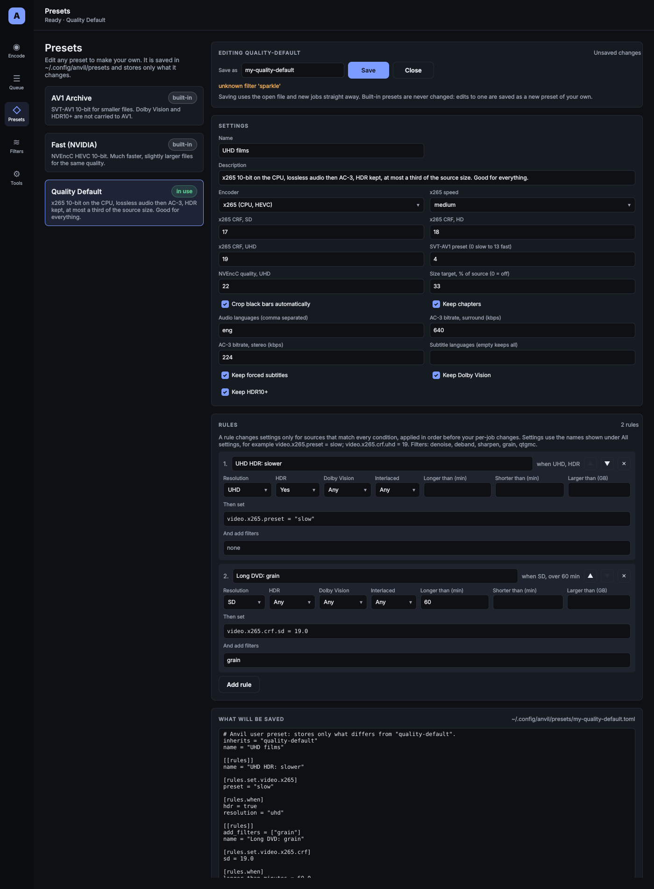
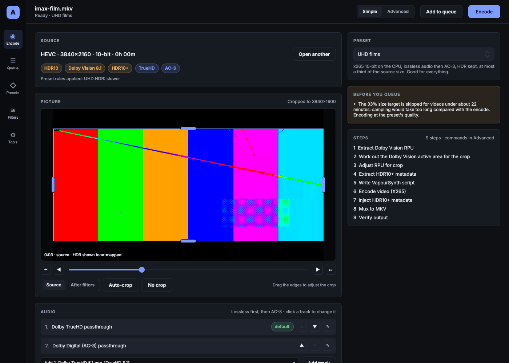
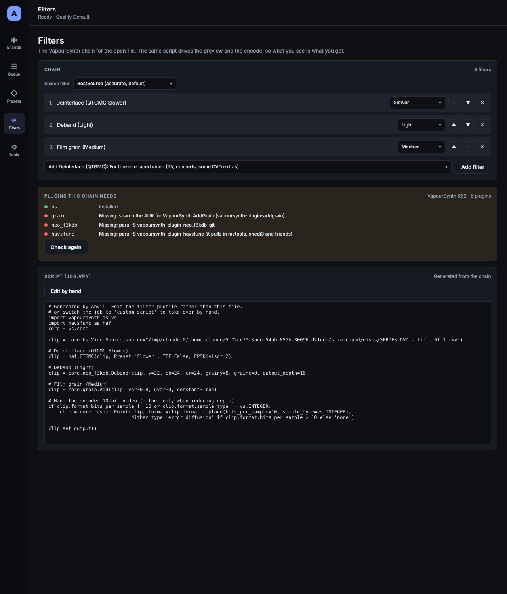

# Phase 4 gate: results

**Gate:** Dolby Vision 8.1 output verified.

**Result: passed in the build environment** (12 November 2026). Two checks need real hardware and are left as procedures below: playback on a Dolby Vision TV, and Dolby Vision through NVEncC on an NVIDIA GPU.

## The run

The source is `GATE_UHD - 00800.mkv`, copied from the synthetic Blu-ray used for the Phase 3 gate: HEVC 10-bit 3840x2160, letterboxed to 2.40:1, HDR10, Dolby Vision profile 8.1 with L5 active-area metadata, HDR10+, TrueHD 5.1 and AC-3 5.1, two chapters.

```
anvil run "GATE_UHD - 00800.mkv" -p gate-fast --autocrop -o out --keep-work
```

`gate-fast` is Quality Default with x265 `ultrafast`, because the build machine has two cores. The job finished in 1:07 with **20 checks passed**, including the new ones:

| Check | Result |
| --- | --- |
| Dolby Vision L5 matches the crop | 518 frames, left 0, right 0, top 0, bottom 0 (the crop removed all the bars) |
| HDR10+ covers every frame | 518 frames of HDR10+ metadata for 518 video frames |
| HDR10+ processing windows | one window (the whole picture), unaffected by the crop |

## Independent checks of the output

**dovi_tool** (RPU extracted from the output video):

```
Frames: 518
Profile: 8
DM version: 2 (CM v4.0)
Scene/shot count: 2
L6 metadata: Mastering display: 0.0001/1000 nits. MaxCLL: 1000 nits, MaxFALL: 400 nits
L5 offsets: top=0, bottom=0, left=0, right=0
L9 MDP: DCI-P3 D65
```

Frame 0's RPU header: `dovi_profile 8`, `vdr_rpu_profile 1`, `disable_residual_flag true` (no enhancement layer), 10-bit base layer, limited range.

**MediaInfo:**

```
HDR format: Dolby Vision, Version 1.0, Profile dvhe.08, Level 06, Settings BL+RPU, HDR10 compatible / SMPTE ST 2094 App 4 (HDR10+ Profile A)
```

**mkvinfo** (what players read before decoding): the video track carries a `dvvC` block addition mapping, bytes `01 00 10 35 10 ...`: version 1.0, profile 8, level 6, RPU present, no enhancement layer, base layer present, **compatibility ID 1** (HDR10). Profile 8 with compatibility ID 1 is what "8.1" means.

Frame rate and duration match the source (518 frames, 21.76 s). The L5 arithmetic for partial crops and IMAX-style scenes (80/0/80 after a 200-pixel crop of 280-pixel bars) was checked the same way earlier in this phase.

## Checklist for your TV (please run once)

Use a film you know well with letterboxed and IMAX-style scenes if possible (for example a Dolby Vision UHD with changing aspect ratios), encoded with Quality Default and auto-crop on.

1. Play the output through the player you normally use (Plex, Jellyfin, Kodi, Infuse, a Zidoo or Nvidia Shield, or the TV's own app from USB).
2. The TV should show its **Dolby Vision** badge or picture mode (on LG: the Dolby Vision logo top right on play; on Sony and Samsung, check the picture mode name). If it shows HDR10 instead, the player is stripping Dolby Vision, not Anvil: test the source file the same way.
3. Check a letterboxed scene and, if present, a full-frame scene: no black bars should be added at the top or bottom, the picture should fill the screen width, and nothing should be cut off.
4. Seek around (beginning, middle, end): the badge should stay, with no flashing or brightness pumping at scene changes.
5. Optional: if your player shows stream info, it should read `dvhe.08.06`, `BL+RPU`, and HDR10+ where the TV supports it.

Reply with the TV and player, and anything odd, and I will turn it into a fix or a note.

## NVEncC Dolby Vision procedure (needs your GPU)

The build machine has no NVIDIA GPU, so this path has only been checked as commands. On your machine, the quickest check is one command:

```
anvil selftest -o ~/anvil-selftest
```

It makes a 10-second HDR10 + Dolby Vision 8.1 test film with letterbox bars, encodes it with every GPU preset your machine can use (auto-crop on) and verifies each result, Dolby Vision L5 after the crop included. `PASS` lines in `~/anvil-selftest/selftest-report.txt` mean it works. To test with a real film instead:

```
anvil tools                                     # NVEncC must be listed with a version
anvil plan film.mkv -p fast-nvenc --autocrop    # the encode step should include --dolby-vision-profile 8.1 and --dolby-vision-rpu
anvil run film.mkv -p fast-nvenc --autocrop -o out
```

Pass: the verification at the end lists `Dolby Vision: profile 8` and `Dolby Vision L5 matches the crop`, and `mediainfo out/film.anvil.mkv` shows `dvhe.08` with `HDR10 compatible`. Then run the TV checklist above on that file too. If NVEncC refuses an option, send me `out/.anvil-work/film/logs/` and the output of `NVEncC --version`.

## Other Phase 4 work

| Item | Notes |
| --- | --- |
| Filter editor | Chain of blocks with strength presets, source filter choice, plugins checked with install hints, generated script shown, hand-edited script used verbatim (a picture-inverting script really inverted the encode). The build machine's `vspipe` stopped loading Python after a container restart, so filtered encodes here were run through a small stand-in for `vspipe`; the real one works the same way on your machine. |
| Preset editor | Edit any preset (built-ins are saved as a copy), save as a user preset that stores only the differences, add rules. A test preset "UHD films" with the rule "UHD HDR: slower" (x265 slow, adds grain) applied to the UHD HDR file and not to a DVD. |
| DVD subtitles and OCR | Finished Phase 3: VobSub extracted from the VOBs, OCR of PGS and VobSub read all six test captions correctly. |






