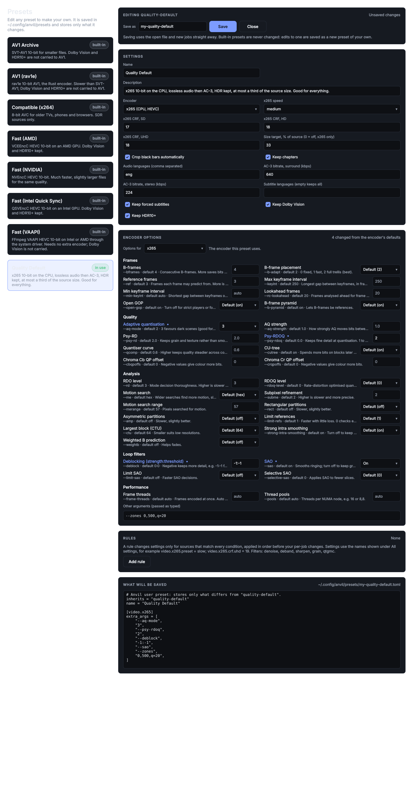
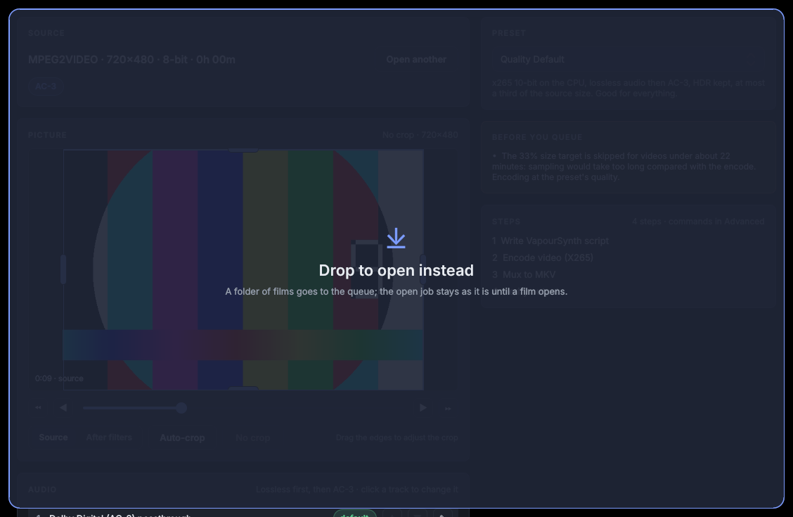

# Phase 5 gate: results

**Gate:** 1.0 release.

**Result: version 1.0.0** (12 November 2026). Everything that can run without a GPU or Flathub access was built and tested here. The checks below that need your hardware are marked as such.

## Encoders

| Encoder | Tested here | Result |
| --- | --- | --- |
| x264 (Compatible preset) | Synthetic DVD title, SDR | 10 checks passed in 0:06: H.264 8-bit 720x480, AC-3 kept |
| rav1e (AV1 preset, speed 10 for the test) | The UHD gate disc: HDR10 + Dolby Vision + HDR10+, cropped to 3840x1600 | 13 checks passed in 11:03: AV1 10-bit, HDR10 mastering display and MaxCLL written, MediaInfo reports SMPTE ST 2086. Dolby Vision and HDR10+ dropped with a warning, as AV1 cannot carry them here |
| QSVEncC, VCEEncC | Command lines (unit tests) | Same colour, HDR10 and Dolby Vision options as NVEncC (rigaya's shared option set); Dolby Vision only for HEVC |
| FFmpeg VAAPI | Command lines (unit tests and plan) | Colours signalled; HDR10+ injected afterwards; Dolby Vision dropped and the missing HDR10 static metadata explained in a warning |

`anvil options --check` compared every option page with the installed tools' `--help`: x265 3.5 (33 options), x264 0.164 (21), SVT-AV1 1.7.0 (16), rav1e 0.7.1 (8) and FFmpeg 6.1 VAAPI (6) all matched. The same comparison runs as a test against saved help texts in `schemas/help/`.

## Hardware detection

Without a GPU the Tools page and `anvil tools` say so plainly ("NVEncC is not installed", "/dev/dri/renderD128 does not exist (no GPU render node)"), and a GPU preset opened on such a machine shows a warning before you queue it. The parsing of `--check-hw` and `vainfo` answers is tested with sample output from NVIDIA, Intel and AMD cards.

## Packaging

| Package | Status |
| --- | --- |
| AppImage | Built here (`dist/Anvil-x86_64.AppImage`, 46 MB) and started in a clean environment: the GUI opened on its bundled Qt, and `cli presets` ran the command-line tool |
| Flatpak | Manifest written with 19 modules; VapourSynth R82 and its plugins come from their official PyPI builds (checksums pinned). 11 of the 15 git sources are pinned to checked tags and commits; x265 (Bitbucket), SVT-AV1 (GitLab) and MKVToolNix (Codeberg) could not be reached from the build machine, so `pin-commits.py` checks and pins them on the first run, and x264 follows its `stable` branch. Rust crates are vendored (`cargo-sources.json`, 219 crates). Not built here: Flathub's runtimes were unreachable |
| GitHub Actions | `.github/workflows/release.yml` tests, builds the AppImage and the Flatpak, and attaches both to a release on every `v*` tag |

## On real hardware (13 November 2026)

`anvil selftest` passed on an NVIDIA machine (Ryzen 9 3950X, CachyOS, VapourSynth R81): Fast (NVIDIA) encoded the HDR10 + Dolby Vision 8.1 test film with auto-crop and every check passed, Dolby Vision L5 after the crop included. Fast (Intel Quick Sync), Fast (AMD) and Fast (VAAPI) were skipped, correctly: no Intel or AMD graphics, and NVIDIA's VAAPI driver only decodes. Two problems found on the way were fixed: rigaya's encoders use lowercase names on Linux, and an AUR build left stale by a library update (`libhdr10plus-rs.so.2`) is now detected and rebuilt.

## On your machine

1. **GPU encoders.** Run `anvil selftest -o ~/anvil-selftest`. It makes a short HDR10 + Dolby Vision test film and encodes it with every GPU preset your machine can use, checking each one; `PASS` lines in `selftest-report.txt` mean that encoder works, Dolby Vision included. Add `--cpu` to test x265 too.
2. **Option pages for your GPU tools.** `anvil options --check` now also checks NVEncC, QSVEncC and VCEEncC. Any option it reports as missing means your version renamed it: send me the line and I will update the page.
3. **Flatpak.** On a machine with Flathub: `python3 packaging/flatpak/pin-commits.py`, then the `flatpak-builder` command at the top of the manifest. Or push a `v1.0.0` tag to GitHub and let the workflow build it. The modules most likely to need a tweak on the first build are MKVToolNix (it builds with `rake`) and the VapourSynth plugins; the build log names the module.

